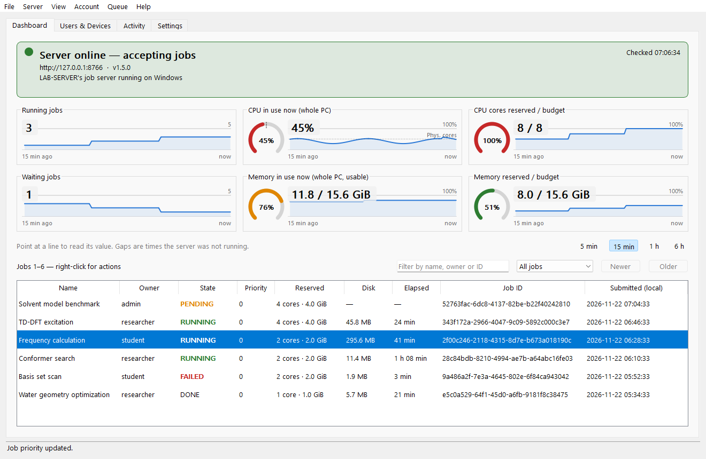
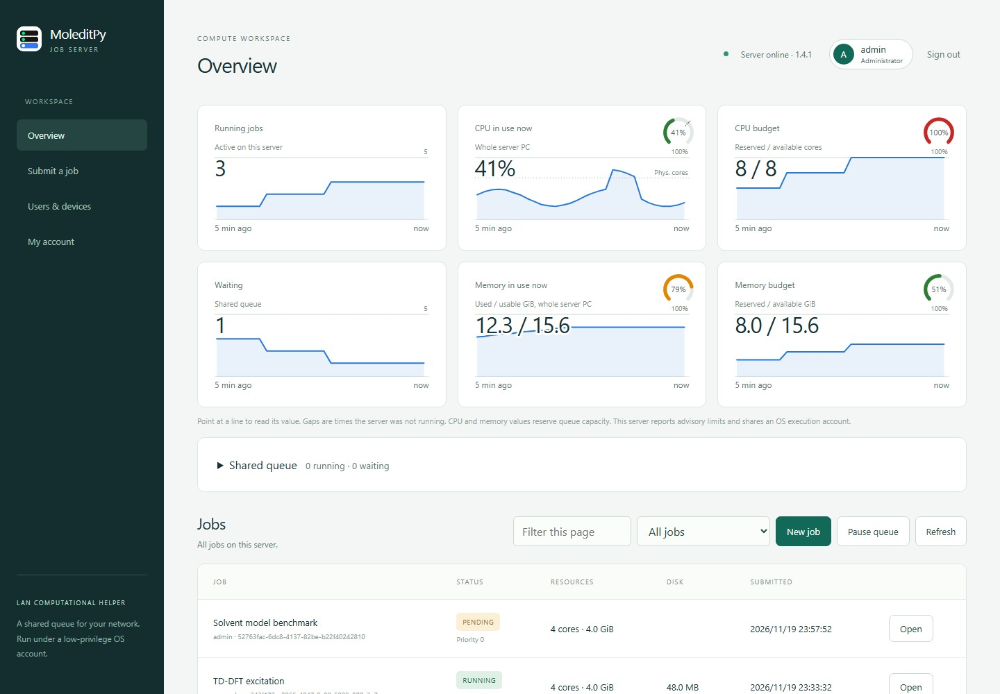

# MoleditPy Job Server

[](https://github.com/HiroYokoyama/moleditpy_job_server/actions/workflows/test.yml)
[](https://github.com/HiroYokoyama/moleditpy_job_server/actions/workflows/security.yml)
[](https://github.com/HiroYokoyama/moleditpy_job_server/actions/workflows/release.yml)
[](https://github.com/HiroYokoyama/moleditpy_job_server/releases)
[](LICENSE)
[](https://github.com/HiroYokoyama/python_molecular_editor)
[](https://doi.org/10.5281/zenodo.23993235)

A shared job queue for one PC on your network. Trusted users submit calculations from
[Job Manager](https://github.com/HiroYokoyama/moleditpy_job_manager), the browser or
Python, and an administrator runs the server from MoleditPy or the command line.

> **Warning:** **Never expose Job Server to the public internet. Use localhost, a private LAN over HTTPS, or a private Tailscale tailnet only.**
> Do not use Tailscale Funnel, router port forwarding, a public reverse proxy, or an internet tunnel.
> Jobs execute arbitrary commands under the service OS account. Only admit trusted users,
> restrict tailnet access, and run under a low-privilege account. Authentication is not an OS sandbox.





## What it does

- **Queue:** CPU and memory budgets, priorities, dependencies, pause and force run. A job
  that only waits, such as a script watching for a file, can ask for 0 cores and 0 memory
  and then takes no share of the budget. A waiting job can be held (`POST /jobs/{id}/hold`)
  by its owner or an administrator; a held job does not start, even when forced.
- **Durable jobs:** jobs run in detached supervisors and a SQLite ledger tracks them, so
  closing MoleditPy or restarting the daemon does not stop a calculation.
- **Accounts:** users and administrators, device keys, password changes and resets,
  enable, disable and delete, with an activity log. See [Accounts](docs/ACCOUNTS.md).
- **Job folders:** open a job's folder in File Explorer on the server PC, or browse and
  download it from the Web UI or Job Manager. See [Job folders](docs/JOB_FOLDERS.md).
- **Local by default:** no listener starts until you ask, and it binds `127.0.0.1`.
  LAN and Tailscale access are explicit opt-ins.

## Quick start

1. In MoleditPy, install the latest **Job Server ZIP** from
   [Releases](https://github.com/HiroYokoyama/moleditpy_job_server/releases) with the Plugin Installer.
2. Open **Extensions → Job Server…**. If Python libraries are missing, it names them.
3. On first use, the setup guide asks for a resource budget and an administrator, then
   starts the server and signs in this window. A new server's budget starts at this PC's size.
4. To reach it from another PC, follow [Connecting from another PC](docs/LAN_SETUP.md) ([日本語](docs/LAN_SETUP_JP.md)).
5. In [Job Manager](docs/JOB_MANAGER.md), add a Job Server host and choose **Sign in / register device**.


Closing the window does not stop the daemon. **Server → Stop** stops it and preserves
running jobs; so does `moleditpy-job-server stop` from a terminal
([command line](docs/HEADLESS.md#administering-from-the-command-line)). If the window cannot verify a running daemon (started by an older version,
or its port changed while it ran), **Start**, **Stop** and **Restart** offer to stop its
process instead. A portable MoleditPy build needs a Python selected in **Settings → Daemon Python runtime**.

## Desktop window

The administrator's console: a dashboard with live CPU and memory dials
beside the reservations, the job list, and tabs for users and devices, the
activity log and settings. Right-click a job, user or device for its
actions. See [the desktop window](docs/DESKTOP_WINDOW.md).

## Web UI

Open **http://127.0.0.1:8766/** on the server PC, or the address you set up
for other PCs. Users submit jobs, follow output, browse job folders and
manage their own account; administrators also get queue controls and user
administration. See [the Web UI](docs/WEB_UI.md).

## Headless server

Python 3.11+, on a low-privilege OS account; Qt and MoleditPy are not needed:

```sh
python -m pip install moleditpy-job-server
moleditpy-job-server init --tls --admin admin
moleditpy-job-server serve
```

The same commands administer the server from a terminal — queue, jobs,
users, devices and the activity log. See
[the headless server and command line](docs/HEADLESS.md).

## Python client

`job_server.client.JobServerClient` submits jobs from Python, with
resumable, hash-verified uploads and downloads. See
[the Python client](docs/PYTHON_CLIENT.md).

## Limits

CPU and memory budgets are **advisory**: they decide when jobs start, not
what a job may use, and all jobs share the service OS account. See
[limits](docs/LIMITS.md) and [Execution and limits](docs/EXECUTION.md).

## Documentation

| Topic | Page |
|---|---|
| Users, passwords, devices and recovery | [Accounts](docs/ACCOUNTS.md) |
| Reaching the server from another PC | [Step by step](docs/LAN_SETUP.md) ([日本語](docs/LAN_SETUP_JP.md)), [LAN details](docs/LAN_ACCESS.md), [HTTPS and Tailscale](docs/REMOTE_ACCESS.md) |
| Connecting from a Mac: certificates and Local Network permission | [Connecting from a Mac](docs/MAC_CLIENT.md) |
| Desktop window | [Desktop window](docs/DESKTOP_WINDOW.md) |
| Web UI | [Web UI](docs/WEB_UI.md) |
| Headless server and the admin command line | [Headless server](docs/HEADLESS.md) |
| Python client | [Python client](docs/PYTHON_CLIENT.md) |
| Job Manager | [Integration](docs/JOB_MANAGER.md) |
| Job folder API | [Job folders](docs/JOB_FOLDERS.md) |
| Running Linux programs from Windows | [WSL](docs/WSL.md) |
| Executors, walltime and storage | [Execution and limits](docs/EXECUTION.md) |
| Security | [SECURITY.md](SECURITY.md), [audit](docs/SECURITY_AUDIT.md), [specification audit](docs/SPEC_AUDIT.md) |
| Testing and releases | [Verification](docs/VERIFICATION.md), [test coverage](docs/TESTING.md), [workflows](docs/WORKFLOWS.md) |

## Development

```sh
git clone --recurse-submodules https://github.com/HiroYokoyama/moleditpy_job_server.git
cd moleditpy_job_server
python -m pip install -e ".[test,gui]"
python -m pytest -q -n 4
python -m ruff check job_server scripts tests integration setup.py
python -m build
python scripts/build_plugin.py
```

## License

LGPL-3.0-or-later. See [LICENSE](LICENSE), [COPYING](COPYING) and
[dependency and provenance terms](LICENSING.md). Upstream execution code and third-party
components keep their own terms.
