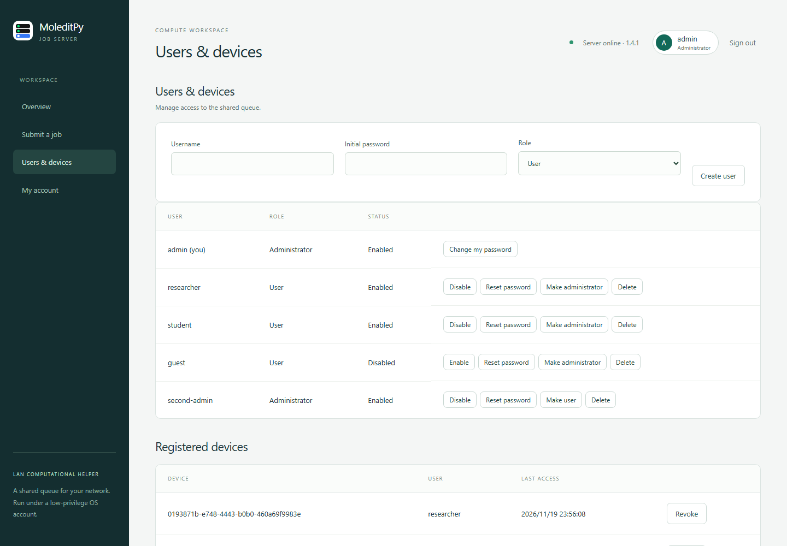

# MoleditPy Job Server

[](https://github.com/HiroYokoyama/moleditpy_job_server/actions/workflows/test.yml)
[](https://github.com/HiroYokoyama/moleditpy_job_server/actions/workflows/security.yml)
[](https://github.com/HiroYokoyama/moleditpy_job_server/actions/workflows/release.yml)
[](https://github.com/HiroYokoyama/moleditpy_job_server/releases)
[](LICENSE)
[](https://github.com/HiroYokoyama/python_molecular_editor)
[](https://doi.org/10.5281/zenodo.23993235)

A shared job queue for one PC on your network. Trusted users submit calculations from
[Job Manager](https://github.com/HiroYokoyama/moleditpy_job_manager), the browser or
Python, and an administrator runs the server from MoleditPy or the command line.

> **Warning:** **Never expose Job Server to the public internet. Use localhost, a private LAN over HTTPS, or a private Tailscale tailnet only.**
> Do not use Tailscale Funnel, router port forwarding, a public reverse proxy, or an internet tunnel.
> Jobs execute arbitrary commands under the service OS account. Only admit trusted users,
> restrict tailnet access, and run under a low-privilege account. Authentication is not an OS sandbox.


## What it does

- **Queue:** CPU and memory budgets, priorities, dependencies, pause and force run. A job
  that only waits, such as a script watching for a file, can ask for 0 cores and 0 memory
  and then takes no share of the budget. A waiting job can be held (`POST /jobs/{id}/hold`)
  by its owner or an administrator; a held job does not start, even when forced. In the
  dashboard, right-click a waiting job to hold or release it, set its priority, change its
  reserved cores and memory, or force it to run past the budget. The
  dashboard shows what is reserved beside what the whole PC is using right now, as dials
  with a trend line under each figure. The server records its load every ten seconds for
  the last six hours, whether or not anyone is signed in.
- **Durable jobs:** jobs run in detached supervisors and a SQLite ledger tracks them, so
  closing MoleditPy or restarting the daemon does not stop a calculation.
- **Accounts:** users and administrators, device keys, password changes and resets,
  enable, disable and delete, with an activity log. See [Accounts](docs/ACCOUNTS.md).
- **Job folders:** open a job's folder in File Explorer on the server PC, or browse and
  download it from the Web UI or Job Manager. See [Job folders](docs/JOB_FOLDERS.md).
- **Local by default:** no listener starts until you ask, and it binds `127.0.0.1`.
  LAN and Tailscale access are explicit opt-ins.

## Quick start

1. In MoleditPy, install the latest **Job Server ZIP** from
   [Releases](https://github.com/HiroYokoyama/moleditpy_job_server/releases) with the Plugin Installer.
2. Open **Extensions → Job Server…**. If Python libraries are missing, it names them.
3. On first use, the setup guide asks for a resource budget and an administrator, then
   starts the server and signs in this window. A new server's budget starts at this PC's size.
4. To reach it from another PC, follow [Connecting from another PC](docs/LAN_SETUP.md) ([日本語](docs/LAN_SETUP_JP.md)).
5. In [Job Manager](docs/JOB_MANAGER.md), add a Job Server host and choose **Sign in / register device**.


Closing the window does not stop the daemon. **Server → Stop** stops it and preserves
running jobs; so does `moleditpy-job-server stop` from a terminal
([command line](#administering-from-the-command-line)). If the window cannot verify a running daemon (started by an older version,
or its port changed while it ran), **Start**, **Stop** and **Restart** offer to stop its
process instead. A portable MoleditPy build needs a Python selected in **Settings → Daemon Python runtime**.

## Desktop window

Right-click a job, user or device for its actions. The same actions are in the menus.


| Tab | Use it to |
|---|---|
| **Dashboard** | See server state, live CPU and memory, reservations and jobs. The job list shows each job's reserved cores and memory and how long it has run, and opens on running and waiting jobs; choose **All jobs** or another filter to see finished and failed ones. Each figure has a dial and a trend line; switch the lines between the last 5 minutes, 15 minutes, 1 hour and 6 hours at the bottom right, and point at a line to read its value. The thin line above each plot is the top of the scale, named at its right end (100%, or for job counts a round number just above the largest shown). A gap in a line is time the server was not running. Memory is shown in GiB (1024-based) of the memory the OS can use, so it reads a little lower than the size on the box. Filter jobs, open details, set priority, force run, cancel or open the job folder. The lists refresh every few seconds without moving your selection or scroll position. |
| **Users & Devices** | Add users or administrators, reset passwords, enable, disable or delete users, switch user and administrator, and revoke devices. Change your own password. |
| **Activity** | Read recent logins, account changes and job events. |
| **Settings** | Set the network, budgets, commands run before each job, the job folder and the runtime. When a save changes something while the server runs, the window offers the restart that applies it. |

Double-click a job to see its command, latest output and result files. The window follows
an unfinished job every 5 seconds until it ends, and keeps the output where you scrolled it
unless you are reading its end.


## Web UI

Open **http://127.0.0.1:8766/** on the server PC, or the address you set up for other PCs.
Users can submit jobs, follow output, browse job folders, download files, change their
password and revoke their own devices. **Shared queue** shows every user's running and
waiting jobs by name and owner, in the order they start, and each waiting job says how
many jobs are ahead of it. Commands, files and output stay private to each job's owner. Administrators also get queue controls and
**Users & devices**.

The overview shows the same dials as the desktop window, with the last 5 minutes drawn
under each figure; point at a line to read a value. The lines come from the server's own
record, so they are already there when you sign in or reload. The record is kept in
memory only: restarting the server starts it again, and the time it was down shows as a gap.

Click a job row to open it, and narrow the list by text or by state (unfinished, finished,
failed or stopped). Each page has its own address, so the browser's Back and Forward move
between pages, a reload stays where you were, and a job's address (`#job/<id>`) can be
bookmarked. Lists refresh in the background without flickering.




Sign-in lasts at most 15 minutes in that tab. Administrator actions need a sign-in
within the last 5 minutes. Browser sign-in registers no device and saves no password.

## Headless server

Python 3.11+, on a low-privilege OS account. Qt and MoleditPy are not needed.

```sh
python -m pip install moleditpy-job-server
moleditpy-job-server init --tls --admin admin
moleditpy-job-server serve
```

`init` writes the whole first configuration, so the first `serve` needs no restart.
With `--tls` it uses this PC's private address when there is only one, creates the
local CA and prints its SHA-256 fingerprint for the client PCs. `--admin` asks for the
password; it is never passed on the command line. Without `--tls` or `--lan-http` the
server is reachable from this PC only.

| Command | Purpose |
|---|---|
| `init` | Write a configuration, with this PC's size as the budget |
| `create-admin` | Create the first administrator, if `init --admin` did not |
| `serve` | Run the server in the foreground |
| `start` / `stop` / `restart` | Run the server in the background, stop it, or both; running jobs continue |
| `status` | Whether the server runs, its addresses, and (signed in) its queue; `--json` for scripts |
| `logs [daemon\|startup\|gui]` | List the server's logs, or print one (`-n LINES`, `-f` to follow) |
| `drain` | Pause the queue, wait until no job runs, then stop: for updating the server safely |
| `gui` | Open the desktop window without MoleditPy (needs the `gui` extra) |
| `reset-password <username>` | Recover a forgotten password on the server PC |

| `init` option | Purpose |
|---|---|
| `--tls` | Serve the LAN address over local HTTPS and create the CA now |
| `--lan-http` | Also serve the LAN address over plain HTTP (unencrypted) |
| `--lan-address IP` | The private address other PCs use; needed when this PC has several |
| `--extra-address IP` | Another private address to listen on (repeatable) |
| `--hostname NAME.local` | This PC's `.local` name |
| `--port`, `--tls-port` | HTTP port (default 8766) and HTTPS port (default 8767) |
| `--cpus`, `--memory-mb` | Resource budget (default: this PC's size) |
| `--data-dir PATH` | Data folder (default `~/.moleditpy/job_server/`) |
| `--description TEXT` | A note about this PC, shown with the server status |
| `--admin USERNAME` | Also create the first administrator |

### Administering from the command line

Everything the window's Queue and Account menus do also works from a terminal on the
server PC. Sign in once; the command line registers as a device of its own and stays
signed in until `logout`:

```sh
moleditpy-job-server login admin          # asks for the password
moleditpy-job-server queue                # running and waiting jobs
moleditpy-job-server jobs --all           # every user's jobs
moleditpy-job-server jobs cancel 3f2a     # a job ID, or its first characters
moleditpy-job-server drain && moleditpy-job-server start
```

| Command | Purpose |
|---|---|
| `login [USERNAME]` / `logout` / `whoami` | Register this command line and sign in; revoke it and sign out; show the account |
| `queue [show\|pause\|resume]` | Show the queue, or keep waiting jobs from starting and let them start again |
| `jobs [list] [--all] [--state S]` | Your jobs, or everyone's (administrator) |
| `jobs show\|log\|cancel\|hold\|release JOB` | One job's details or log (`-f` to follow), cancel it, hold or release it |
| `jobs priority\|resources\|owner\|force-run\|mark-lost JOB ...` | The administrator's job controls, as in the window |
| `jobs move-finished` | Queue finished jobs for the finished-jobs folder |
| `users [list\|add\|disable\|enable\|delete\|role\|password]` | Manage accounts (administrator); passwords are asked for |
| `devices [list\|revoke ID]` | Registered devices, and revoking one (administrator) |
| `events [-n N]` | The newest entries of the activity log (administrator) |

Actions that cannot be undone ask first; `-y` answers for scripts. List commands take
`--json`. Text other users chose — job names, logs — is printed with terminal control
characters replaced. `start`, `stop`, `restart`, `status` and `logs` need no sign-in, with
the same authority over this PC's server as `reset-password`; signed in, `stop` shuts down
through the API and the activity log records who did. On Windows, stopping without
signing in needs `--force`, because ending the process skips the clean shutdown.
`drain` leaves the queue paused; resume it with `queue resume` after the next `start`.
A server run by systemd ([deploy/job-server.service](deploy/job-server.service)) is
better started and stopped with `systemctl --user`.

Every command accepts `--config /path/to/settings.json`. Data lives in
`~/.moleditpy/job_server/`. Install `moleditpy-job-server[gui]` for the desktop window.
The window also opens without MoleditPy — `python -m job_server gui`, or
`launch_job_server.bat` on Windows — and a second launch brings the running
window to the front instead of opening another.

With MoleditPy 5.3 or later, the plugin installed through the Plugin Installer
runs the same commands from its plugin folder, with no separate install:
`moleditpy -r job_server gui` opens the window, `moleditpy -r job_server serve`
runs the server, and so on. Hints the commands print then name that form too.

Status answers (`status`, the web monitor, the API) name the PC they came
from: its hostname and a fixed line — "<PC>'s job server running on <OS>".
The name is answered before sign-in, so a client can tell which PC it
reached. The owner's own description of the PC, set in the window's
Settings tab or with `init --description`, rides in `/health` too, so a
person or an AI agent meeting the server for the first time knows what
the PC is for; the web monitor shows it on the sign-in screen. `/health`
is answered before sign-in, so anyone who can reach the server can read
the note — write it as a note, not a secret. The other status answers do
not carry it.

## Python client

```python
from job_server.client import JobServerClient

client = JobServerClient("https://compute.example.org", "device.key")
# Once per device: client.enroll("alice", initial_password)
job = client.submit(
    {"name": "example", "command": "mycommand {input} > {stem}.out",
     "resources": {"cpus_per_task": 2, "memory_mb": 1024, "walltime_seconds": 3600}},
    {"input.inp": "./input.inp"},
    idempotency_key="b176bbfe-bc31-463e-af17-18a2f0678dbd",
)
status = client.request("GET", f"/jobs/{job['id']}")
client.download(job["id"], "result.out", "./results/result.out")
```

Reuse an idempotency key to retry a submission. Uploads and Python downloads resume and
verify SHA-256. Browser downloads hold the file in memory, so use Python for large results.

## Limits

CPU and memory budgets are **advisory**: they decide when jobs start, not what a job may
use. The CPU budget counts physical cores, and a new server starts at this PC's core
count rather than its thread count: with hyper-threading a PC has more threads than cores,
and calculations rarely gain from the extra ones. On Linux only the CPUs the server may
run on count (`taskset`, containers, systemd limits). All jobs share the service OS
account, so they are not isolated from each other.
This is a service for trusted users. See [SECURITY.md](SECURITY.md) and
[Execution and limits](docs/EXECUTION.md).

**CPU in use now** is a share of every thread, so 100% means all threads are busy. When
the PC has more threads than cores, a dotted line on its trend ("Phys. cores") and a
dotted tick on its dial mark where every core is busy. The dial's colour follows the cores: green, amber from 70% of them, red from 90%
up to every core busy and a little beyond (10 points of the whole PC, since the OS uses some too), and purple past that, when jobs share cores with hyper-threads.

## Documentation

| Topic | Page |
|---|---|
| Users, passwords, devices and recovery | [Accounts](docs/ACCOUNTS.md) |
| Reaching the server from another PC | [Step by step](docs/LAN_SETUP.md) ([日本語](docs/LAN_SETUP_JP.md)), [LAN details](docs/LAN_ACCESS.md), [HTTPS and Tailscale](docs/REMOTE_ACCESS.md) |
| Connecting from a Mac: certificates and Local Network permission | [Connecting from a Mac](docs/MAC_CLIENT.md) |
| Job Manager | [Integration](docs/JOB_MANAGER.md) |
| Job folder API | [Job folders](docs/JOB_FOLDERS.md) |
| Running Linux programs from Windows | [WSL](docs/WSL.md) |
| Executors, walltime and storage | [Execution and limits](docs/EXECUTION.md) |
| Security | [SECURITY.md](SECURITY.md), [audit](docs/SECURITY_AUDIT.md), [specification audit](docs/SPEC_AUDIT.md) |
| Testing and releases | [Verification](docs/VERIFICATION.md), [test coverage](docs/TESTING.md), [workflows](docs/WORKFLOWS.md) |

## Development

```sh
git clone --recurse-submodules https://github.com/HiroYokoyama/moleditpy_job_server.git
cd moleditpy_job_server
python -m pip install -e ".[test,gui]"
python -m pytest -q -n 4
python -m ruff check job_server scripts tests integration setup.py
python -m build
python scripts/build_plugin.py
```

## License

LGPL-3.0-or-later. See [LICENSE](LICENSE), [COPYING](COPYING) and
[dependency and provenance terms](LICENSING.md). Upstream execution code and third-party
components keep their own terms.
