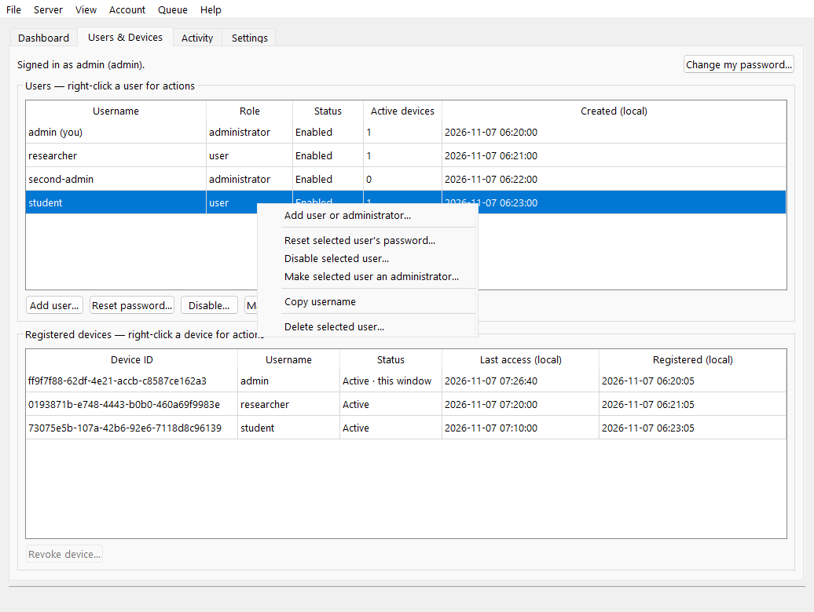

# Desktop window

The dashboard also runs as its own window, without MoleditPy open. Started
that way it has its own taskbar or Dock entry with the Job Server icon. Opened
from MoleditPy's menu, it belongs to MoleditPy and shows MoleditPy's icon.

## Windows

Nothing to install. Run the window with either command; the taskbar shows the
Job Server icon.

```powershell
python -m moleditpy -r job_server gui
```

```powershell
moleditpy-job-server gui
```

The first is for the plugin installed in MoleditPy, the second for
`pip install "moleditpy-job-server[gui]"`.

## Ubuntu: launcher and desktop icon

GNOME shows a window's icon only when a launcher with the same ID is installed,
so add one once. Use the Python that runs MoleditPy (or that has
`moleditpy-job-server[gui]` installed):

```sh
python3 -m moleditpy -r job_server install-launcher
```

or, for the pip package, `moleditpy-job-server install-launcher`. The name
after `-r` is the plugin's folder under `~/.moleditpy/plugins`: `job_server`
from the Plugin Installer, or whatever you named a cloned copy (see
`python3 -m moleditpy --list-plugins`).

This writes three files:

| File | What it is |
|---|---|
| `~/.local/share/applications/hyoko.moleditpy.jobserver.desktop` | the launcher in the application list |
| `~/.local/share/icons/hicolor/128x128/apps/hyoko.moleditpy.jobserver.png` | the icon |
| `~/Desktop/hyoko.moleditpy.jobserver.desktop` | the desktop icon (`~/デスクトップ` on a Japanese desktop) |

Open **MoleditPy Job Server** from the application list or the desktop icon,
and it appears in the Dock with the Job Server icon. To keep it there,
right-click it in the Dock and choose **Pin to Dash**. Add `--no-desktop-icon`
to skip the desktop icon, and `--config PATH` to open a particular
configuration.

The launcher records the Python that ran the command and the plugin folder, so
run the command again after moving either (a new virtual environment, a
reinstalled MoleditPy). Updating the plugin does not need it.

If the desktop icon shows as a plain file, right-click it and choose **Allow
Launching**. If the window opens but the Dock still shows a generic icon, the
window was started some other way (an older hand-written launcher, or the
MoleditPy menu): delete old `.desktop` files for the Job Server and start it
from the new launcher.

The ID `hyoko.moleditpy.jobserver` follows the main application's
`hyoko.moleditpy.<major>`. It is the Windows taskbar ID, the Wayland app ID and
the X11 window class, and the launcher's file name must match it.

Right-click a job, user or device for its actions. The same actions are in the menus.



| Tab | Use it to |
|---|---|
| **Dashboard** | See server state, live CPU and memory, reservations and jobs. The job list shows each job's reserved cores and memory and how long it has run, and opens on running and waiting jobs; choose **All jobs** or another filter to see finished and failed ones. Each figure has a dial and a trend line; switch the lines between the last 5 minutes, 15 minutes, 1 hour and 6 hours at the bottom right, and point at a line to read its value. The thin line above each plot is the top of the scale, named at its right end (100%, or for job counts a round number just above the largest shown). A gap in a line is time the server was not running. Memory is shown in GiB (1024-based) of the memory the OS can use, so it reads a little lower than the size on the box. Filter jobs, open details, set priority, force run, cancel or open the job folder. The lists refresh every few seconds without moving your selection or scroll position. |
| **Users & Devices** | Add users or administrators, reset passwords, enable, disable or delete users, switch user and administrator, and revoke devices. Change your own password. |
| **Activity** | Read recent logins, account changes and job events. |
| **Settings** | Set the network, budgets, commands run before each job, the job folder and the runtime. When a save changes something while the server runs, the window offers the restart that applies it. |

Double-click a job to see its command, latest output and result files. The window follows
an unfinished job every 5 seconds until it ends, and keeps the output where you scrolled it
unless you are reading its end.


