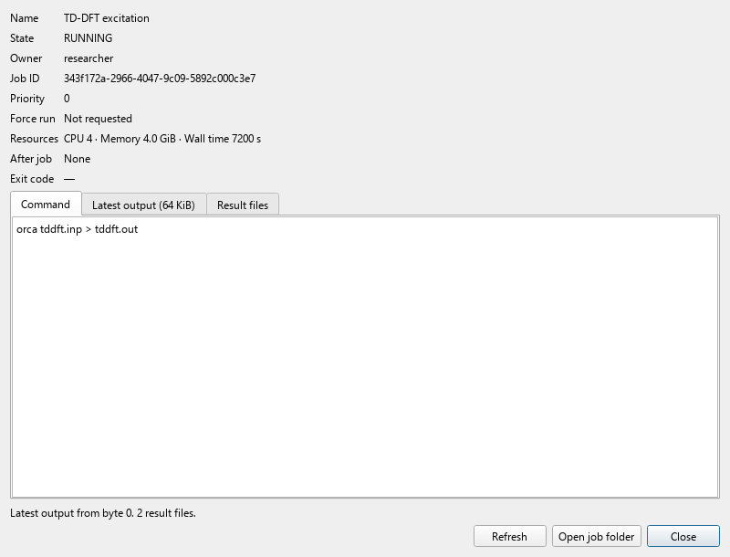

# Desktop window

The standalone dashboard uses the Job Server icon in the Windows taskbar.
On Ubuntu, install the desktop entry and icon so GNOME can associate the
dashboard window with its application in the Dock. From the source directory,
after installing `moleditpy-job-server[gui]`, run:

```sh
data_dir="${XDG_DATA_HOME:-$HOME/.local/share}"
app_id=hyoko.moleditpy.jobserver
install -Dm644 "$app_id.desktop" "$data_dir/applications/$app_id.desktop"
install -Dm644 job_server/web/icon.png "$data_dir/icons/hicolor/128x128/apps/$app_id.png"
```

Open **MoleditPy Job Server** from the application list. If you installed in a
virtual environment, edit the installed desktop entry's `Exec` line to use the
absolute path to that environment's `moleditpy-job-server` command, followed by
`gui`.

Right-click a job, user or device for its actions. The same actions are in the menus.


| Tab | Use it to |
|---|---|
| **Dashboard** | See server state, live CPU and memory, reservations and jobs. The job list shows each job's reserved cores and memory and how long it has run, and opens on running and waiting jobs; choose **All jobs** or another filter to see finished and failed ones. Each figure has a dial and a trend line; switch the lines between the last 5 minutes, 15 minutes, 1 hour and 6 hours at the bottom right, and point at a line to read its value. The thin line above each plot is the top of the scale, named at its right end (100%, or for job counts a round number just above the largest shown). A gap in a line is time the server was not running. Memory is shown in GiB (1024-based) of the memory the OS can use, so it reads a little lower than the size on the box. Filter jobs, open details, set priority, force run, cancel or open the job folder. The lists refresh every few seconds without moving your selection or scroll position. |
| **Users & Devices** | Add users or administrators, reset passwords, enable, disable or delete users, switch user and administrator, and revoke devices. Change your own password. |
| **Activity** | Read recent logins, account changes and job events. |
| **Settings** | Set the network, budgets, commands run before each job, the job folder and the runtime. When a save changes something while the server runs, the window offers the restart that applies it. |

Double-click a job to see its command, latest output and result files. The window follows
an unfinished job every 5 seconds until it ends, and keeps the output where you scrolled it
unless you are reading its end.


