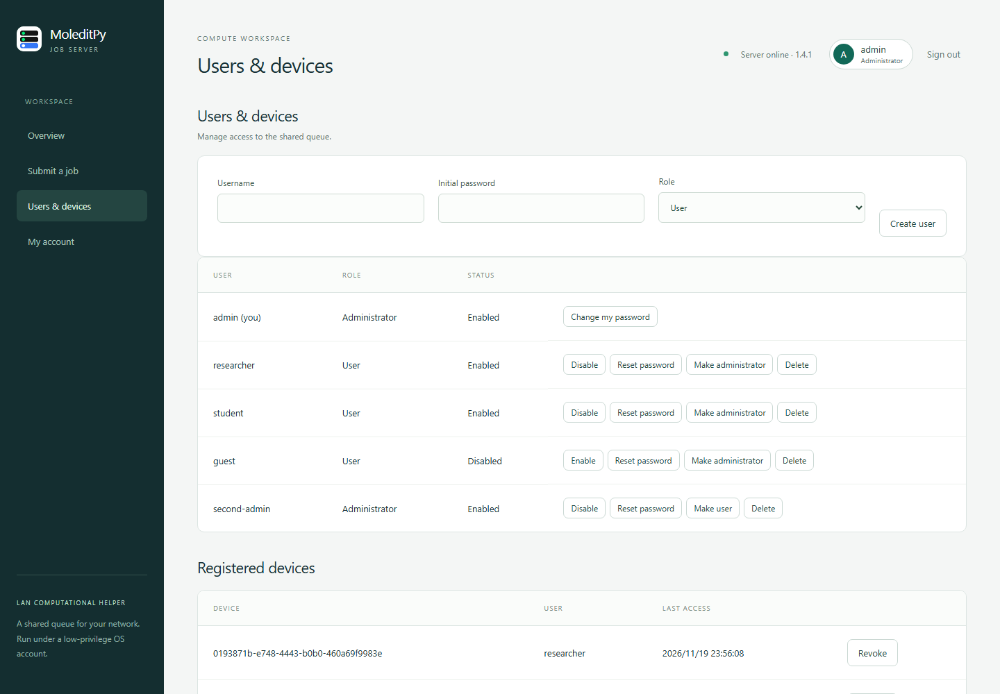
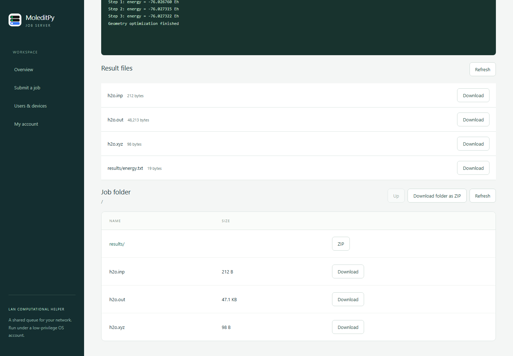

# Web UI

Open **http://127.0.0.1:8766/** on the server PC, or the address you set up for other PCs.
Users can submit jobs, follow output, browse job folders, download files, change their
password and revoke their own devices. **Shared queue** shows every user's running and
waiting jobs by name and owner, in the order they start, and each waiting job says how
many jobs are ahead of it. Commands, files and output stay private to each job's owner. Administrators also get queue controls and
**Users & devices**.

The overview shows the same dials as the desktop window, with the last 5 minutes drawn
under each figure; point at a line to read a value. The lines come from the server's own
record, so they are already there when you sign in or reload. The record is kept in
memory only: restarting the server starts it again, and the time it was down shows as a gap.

Click a job row to open it, and narrow the list by text or by state (unfinished, finished,
failed or stopped). Each page has its own address, so the browser's Back and Forward move
between pages, a reload stays where you were, and a job's address (`#job/<id>`) can be
bookmarked. Lists refresh in the background without flickering.

Sign-in lasts at most 15 minutes in that tab. Administrator actions need a sign-in
within the last 5 minutes. Browser sign-in registers no device and saves no password.
